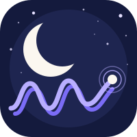
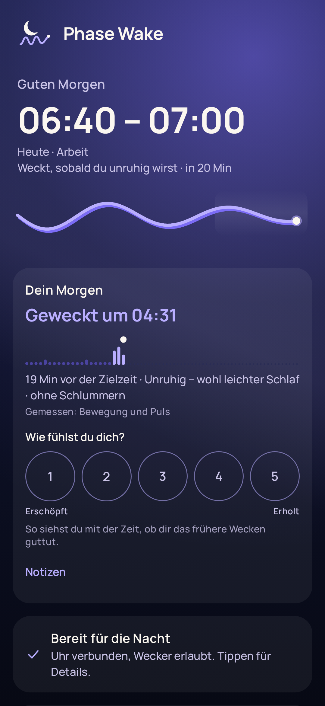
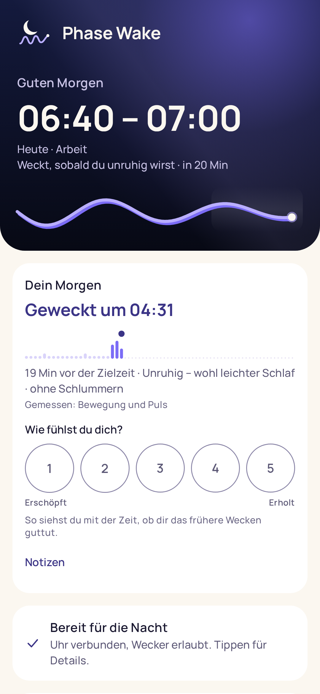
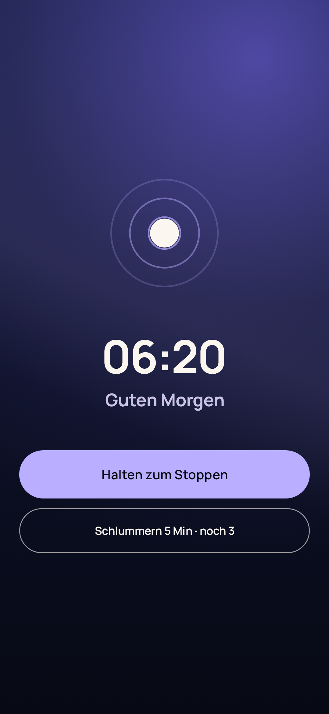

<p align="center"></p>

<h1 align="center">Phase Wake</h1>

<p align="center">
Schlafphasenwecker für <b>Galaxy Watch</b> und <b>Apple Watch</b>.<br>
Phase Wake weckt dich in deinem Weckfenster, sobald du unruhig wirst – dann schläfst du wohl leicht. Spätestens zur Zielzeit (Apple Watch ohne laufende Messung etwa 1 Minute danach).<br>
Open Source · ohne Konto · ohne Server · ohne Abo<br>
<sub>Stand: in Entwicklung, noch nicht in den Stores.</sub>
</p>

<p align="center">
<a href="https://github.com/r1adBE/phaseWake/actions/workflows/ci.yml"></a>
<a href="LICENSE"></a>
</p>

<p align="center">



</p>

<p align="center"><a href="https://github.com/r1adBE/phaseWake/tree/screenshots">Alle Bildschirme ansehen →</a></p>

## So funktioniert es

Du stellst eine Zielzeit und ein Weckfenster (10–30 Minuten). Im Fenster misst die Uhr Bewegung und Puls in 30-Sekunden-Abschnitten. Sobald du unruhig wirst, weckt sie dich – sanft per Vibration, auf Wunsch mit Ton. Die Galaxy Watch weckt spätestens zur Zielzeit; die Apple Watch ohne laufende Messung spätestens etwa 1 Minute danach per Mitteilung. Vor iOS 26 ist der Zweitwecker am iPhone eine Mitteilung (der Stummschalter macht sie lautlos).

- **Weckfenster** vor der Zielzeit, frei einstellbar
- **Einschlaf-Modus**: «7½ Stunden schlafen» ab dem Einschlafen, nie später als die gewählte Zeit. Galaxy Watch: misst das Einschlafen; Apple Watch: «Gute Nacht» schätzt es aus deiner gelernten Einschlafdauer
- **Weckart** pro Wecker: Uhr mit Vibration oder Ton, Handy als Zweitwecker (aus, Vibration, Vibration + Ton); auf Apple weckt die Uhr per Haptik und das iPhone mit Ton – ab iOS 26 als Wecker, der auch bei «Nicht stören» und im Schlaf-Fokus klingelt, davor als Mitteilung
- **Wecktöne**, die leise beginnen: Morgenvögel, Glockenspiel, Sanfter Gong, Harfe oder ein Klingelton des Systems
- **Sonnenaufgang** (Option) auf dem Handy und/oder der Galaxy Watch: Der Bildschirm wird von schwachem Orange zu hellem, warmem Licht – ab Weckfenster oder beim Wecken; auf Apple nur auf dem iPhone, im Nachttisch-Modus
- **Schlummern** 5 Minuten, höchstens 3×
- **Nacht-Check** vor dem Schlafen: Uhr verbunden, Wecker erlaubt, «Nicht stören», Akku – mit Knopf zum Beheben
- **Morgenbericht**: wann und warum geweckt wurde, worauf die Entscheidung beruhte, dein Befinden (1–5) und ein Tipp
- **Trends**: Schlafdauer und Regelmässigkeit (aus Health Connect bzw. Apple Health) und dein Befinden im Wochenvergleich
- **Schlafnotizen, Schlafziel, Bettzeit-Erinnerung und Einschlafklänge** auf dem Handy – Rauschen (weiss, rosa, braun), Ventilator, Einschlaf-Wellen (mit Kopfhörern) und Aufnahmen von Regen, Meer, Wald bei Nacht, Kaminfeuer und Bach
- **Geräusche in der Nacht** (Option pro Nacht, standardmässig aus): erkennt mögliches Schnarchen und Sprechen über das Mikrofon des Handys, behält nur kurze Ausschnitte zum Anhören, nach 7 Tagen gelöscht – alles bleibt auf dem Handy
- **Gewohnheiten**: «Regelmässig ins Bett: N von 7 Abenden», Serien mit erreichtem Schlafziel, Wochenrückblick am Sonntag (Option) und eine eigene Abendroutine zum Abhaken
- **Weckaufgabe** (Option pro Wecker, Android): Zum Beenden 3 Rechenaufgaben am Handy lösen statt halten; Schlummern geht ohne Aufgabe
- **Verlauf** der letzten 90 Nächte mit Bewegungskurve; optional die Schlafphasen aus Health Connect bzw. Apple Health zum Vergleich
- **Gleicht ab**: Nach drei aufgezeichneten Nächten werden die Schwellen an deine Bewegungswerte angepasst, also ab der vierten Nacht.
- **Lernphase** (Option): Nur wenn du sie startest, zeichnet die Uhr 7 Nächte lang über die ganze Nacht Bewegung und Puls auf und passt danach den Wecker an dich an; jederzeit in den Einstellungen abschaltbar. Galaxy Watch: in Stichproben (60 Sekunden alle 5 Minuten, Start ab 50 % Akku; Akkubedarf geschätzt, noch nicht gemessen – gemessen ist nur «Nacht aufzeichnen» durchgehend: ca. 6 % pro Stunde). Apple Watch: Bewegung über den Bewegungs-Rekorder von watchOS (Start frühestens 1 Stunde vor der Bettzeit, wenn du die Uhr-App öffnest, ab 50 % Akku; Auswertung nach dem Wecken), Puls und «Im Bett» aus Apple Health
- **Genau** (Option pro Wecker): ohne Weckfenster, klingelt genau zur Zielzeit; die Uhr misst trotzdem für den Verlauf
- **Kurze Nacht**: Hast du deutlich weniger als dein Schlafziel geschlafen, weckt die Uhr frühestens 10 Minuten vor der Zielzeit. Galaxy Watch: dein Einschlafen erkennt sie dafür automatisch (ab 1 Stunde vor der Bettzeit misst sie kurz die Bewegung, bis du eingeschlafen bist; standardmässig ein, abschaltbar in den Einstellungen). Apple Watch: gleich, über den Bewegungs-Rekorder von watchOS (gleicher Schalter); er startet ab 1 Stunde vor der Bettzeit, wenn du die Uhr-App öffnest – die Uhr erinnert dich dann mit einer Mitteilung, und das Öffnen stellt auch den Wecker scharf. Lief der Rekorder, aber die Einschlafzeit bleibt unbekannt, weckt die Uhr ebenfalls frühestens 10 Minuten vor der Zielzeit (auf beiden Uhren gleich)
- **Kachel und Komplikation** auf der Uhr
- **Hell, Dunkel, System** – und barrierefrei mit Bildschirmleser
- **74 Sprachen**

Die Erkennungsregel ist offen dokumentiert: [docs/PHASENERKENNUNG.md](docs/PHASENERKENNUNG.md).

## Datenschutz

Alles bleibt auf Handy und Uhr. Kein Konto, kein Server, keine Werbung, keine Auswertung. Wer helfen will, die Erkennung zu verbessern, kann seine Nächte freiwillig als CSV-Datei ohne Namen exportieren. Die Datei enthält je Nacht Bewegung und Puls je 30 Sekunden, dein Befinden und deine Notizen, aber keinen Namen, kein Konto, kein Datum und keine Gerätekennung. Handy und Uhr tauschen Wecker und Nächte direkt aus (Android: als Nachricht, nicht als Datenpaket in der Google-Cloud; Apple: WatchConnectivity), siehe [Datenschutz](docs/DATENSCHUTZ.md).

## Aufbau

| Ordner | Inhalt |
|---|---|
| `android/core` | Phasenerkennung und Logik, reines Kotlin, vollständig getestet |
| `android/shared` | Speicher und Abgleich Handy ↔ Uhr |
| `android/app` | Android-App (Jetpack Compose) |
| `android/wear` | Wear-OS-App für die Galaxy Watch (Compose for Wear OS) |
| `ios/PhaseWakeCore` | Dieselbe Logik in Swift, gleiche Tests |
| `ios/PhaseWake` | iPhone-App (SwiftUI) |
| `ios/PhaseWakeWatch` | Apple-Watch-App (SwiftUI, Smart-Alarm-Sitzung) |
| `shared/testdata` | Testnächte, die beide Plattformen identisch bewerten müssen |
| `docs` | Konzept, Entscheide, Erkennungsregel, Testanleitung, Datenschutz, Logo |

## Testen

Fertige Testversion für Android-Handy und Galaxy Watch: [Releases → test](https://github.com/r1adBE/phaseWake/releases/tag/test). Anleitung Schritt für Schritt: [docs/TESTEN.md](docs/TESTEN.md).

Die Testversion ist ein Debug-Build, signiert mit dem öffentlichen Test-Schlüssel aus `android/testing/` – nur zum Testen gedacht: Jeder kann eine App mit demselben Schlüssel bauen, und ein Debug-Build lässt sich am Gerät untersuchen. Die Versionen in den Stores werden mit einem privaten Schlüssel signiert. Die Testversion hat eine eigene Kennung (`com.phasewake.app.test`) und lässt sich neben der Store-Version installieren. Eine ältere Testversion (noch mit der Kennung der Store-Version) einmal deinstallieren, vorher eine Sicherung anlegen.

## Bauen

Android (JDK 21):

```sh
cd android
./gradlew :core:test :app:assembleDebug :wear:assembleDebug
```

Apple (macOS mit Xcode 26):

```sh
cd ios/PhaseWakeCore && swift test
open ../PhaseWake.xcodeproj
```

Die Texte der Apple-Apps entstehen aus den Android-Texten: `python3 .github/scripts/gen-xcstrings.py`.

Modell für «Geräusche in der Nacht» (Android): YAMNet von MediaPipe, nicht im Repository. Gradle lädt es beim ersten Bauen nach `android/app/src/main/assets/yamnet.tflite` (Quelle: `https://storage.googleapis.com/mediapipe-models/audio_classifier/yamnet/float32/1/yamnet.tflite`). Der Build prüft die Datei mit SHA-256 (Wert in `android/app/build.gradle.kts`) und bricht bei einer anderen Datei ab.

Ohne Modell baut und läuft die App ebenfalls; aufgenommene Geräusche gelten dann alle als «anderes Geräusch».

## Unterstützen

Phase Wake ist gratis, ohne Werbung und ohne Abo. Wer die Entwicklung unterstützen möchte: [GitHub Sponsors](https://github.com/sponsors/r1adBE).

## Lizenz

[MIT](LICENSE) © r1adBE · Schrift [Manrope](licenses/Manrope-OFL.txt) unter SIL Open Font License 1.1 · Android: [MediaPipe Tasks Audio](https://github.com/google-ai-edge/mediapipe) und das Modell [YAMNet](https://www.kaggle.com/models/google/yamnet) unter [Apache License 2.0](https://www.apache.org/licenses/LICENSE-2.0), © Google LLC · Feiertage: Daten aus dem Python-Paket [holidays](https://github.com/vacanza/holidays) unter MIT-Lizenz · nur für Tests: [Robolectric](https://robolectric.org) (MIT)

Klänge: freie Aufnahmen unter [CC0](https://creativecommons.org/publicdomain/zero/1.0/) von opengameart.org, für die App zu nahtlosen Schleifen geschnitten bzw. als Weckton aufbereitet:

- Regen: [«Rain (loopable)»](https://opengameart.org/content/rain-loopable) von Ylmir
- Meer: [«Sea and river wave sounds» (Vistula)](https://opengameart.org/content/sea-and-river-wave-sounds) von RandomMind
- Wald bei Nacht: [«Crickets ambient noise»](https://opengameart.org/content/crickets-ambient-noise-loopable) von Wolfgang_
- Kaminfeuer: [«Fireplace sound loop»](https://opengameart.org/content/fireplace-sound-loop) von PagDev
- Bach: [«30 CC0 SFX loops»](https://opengameart.org/content/30-cc0-sfx-loops) (water_flowing) von rubberduck
- Weckton Morgenvögel: [«Ambient bird sounds»](https://opengameart.org/content/ambient-bird-sounds) von isaiah658

Glockenspiel, Sanfter Gong und Harfe sowie Rauschen, Ventilator und Einschlaf-Wellen sind synthetisch erzeugt.
